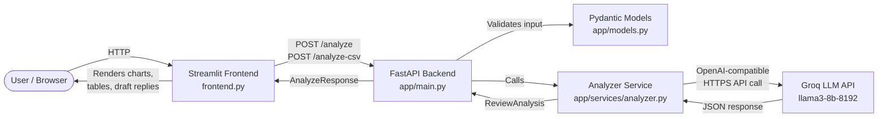

# Technical Approach Report
## Revio AI — Review Intelligence Copilot

---

## Architecture Overview



---

## Component Responsibilities

| Component | File | Responsibility |
|---|---|---|
| **FastAPI app** | `app/main.py` | Route definitions, HTTP error handling, settings |
| **Pydantic models** | `app/models.py` | Request/response schema validation |
| **Analyzer service** | `app/services/analyzer.py` | LLM client creation, prompt construction, response parsing |
| **Streamlit frontend** | `frontend.py` | UI, user input, backend API calls, result display |
| **Tests** | `tests/test_api.py` | Endpoint tests with mocked LLM |

---

## Request-to-Response Data Flow

### Single Review (`POST /analyze`)

1. User pastes review text in Streamlit → clicks **Analyze Review**.
2. Streamlit sends `POST /analyze` to FastAPI with `{"review_text": "..."}`.
3. FastAPI validates input via `AnalyzeRequest` (Pydantic):
   - Must be non-empty, non-blank, max 2 000 characters.
4. `analyze_review()` in `analyzer.py`:
   - Creates `AsyncOpenAI` client with Groq base URL + API key.
   - Sends system prompt + review text to `chat.completions.create`.
   - Parses JSON response; validates against `ReviewAnalysis` model.
5. FastAPI returns `AnalyzeResponse` (HTTP 200) or error (HTTP 422/502/500).
6. Streamlit displays sentiment, urgency, topic, explanation, action, and draft reply.

### Batch Analysis (`POST /analyze-csv`)

1. User uploads CSV → clicks **Analyze All Reviews**.
2. Streamlit POSTs file as `multipart/form-data` to `/analyze-csv`.
3. FastAPI:
   - Reads file bytes; checks size ≤ 5 MB.
   - Parses CSV with `csv.DictReader`; extracts `review_text` column.
   - Validates row count ≤ 100.
4. `analyze_reviews_batch()` calls `analyze_review()` for each row sequentially.
5. Aggregates: sentiment/urgency counts, top-3 topics, negative explanations.
6. Returns `CSVAnalyzeResponse` with all analyses + aggregate data.
7. Streamlit renders Plotly pie/bar charts, summary, tables, draft replies.

---

## Technology Choices

| Technology | Reason |
|---|---|
| **FastAPI** | Modern async Python web framework; auto-generates OpenAPI docs at `/docs` |
| **Pydantic v2** | Fast validation, clear error messages, JSON serialization |
| **pydantic-settings** | Type-safe environment variable loading with `.env` file support |
| **OpenAI SDK (v1.x)** | Groq exposes an OpenAI-compatible interface; no custom HTTP layer needed |
| **Groq / llama3-8b-8192** | Fast inference, free tier available, JSON mode supported |
| **Streamlit** | Rapid dashboard development; built-in file uploader, session state, secrets |
| **Plotly** | Interactive pie/bar charts directly in Streamlit |
| **Pandas** | CSV parsing and DataFrame display |
| **Pytest** | Simple, powerful test framework; async mock support via `unittest.mock` |
| **python-dotenv** | Local `.env` loading without modifying environment |

---

## Prompt Engineering

### System prompt design

```
You are an AI assistant that analyses a single customer review.
Return ONLY a valid JSON object with these exact keys:
{
  "sentiment": "Positive" or "Negative" or "Neutral",
  "topic": "short description of the main issue",
  "urgency": "Low" or "Medium" or "High",
  "explanation": "brief explanation of your classification",
  "recommended_action": "suggested business action",
  "draft_reply": "draft customer reply (requires human approval before sending)"
}
Do not include any text outside the JSON object.
```

**Design decisions:**
- **JSON mode** (`response_format={"type": "json_object"}`) enforced at the API level — the LLM cannot return free text.
- **Explicit enum values** listed in the prompt constrain valid outputs.
- **Temperature = 0.0** — deterministic, consistent classifications.
- **Draft reply label** in prompt includes the approval reminder to reinforce human-in-the-loop requirement.
- **Post-prompt Pydantic validation** catches any enum mismatches before returning to the client.

---

## Structured Output Schema

```python
class Sentiment(str, Enum):
    POSITIVE = "Positive"
    NEGATIVE = "Negative"
    NEUTRAL = "Neutral"

class Urgency(str, Enum):
    LOW = "Low"
    MEDIUM = "Medium"
    HIGH = "High"

class ReviewAnalysis(BaseModel):
    sentiment: Sentiment
    topic: str
    urgency: Urgency
    explanation: str
    recommended_action: str
    draft_reply: str
```

All fields are required. The `Sentiment` and `Urgency` enums reject any value not in the allowed set.

---

## Backend API Design

| Endpoint | Method | Request | Response | Error codes |
|---|---|---|---|---|
| `/health` | GET | — | `{"status": "ok"}` | — |
| `/analyze` | POST | `{"review_text": str}` | `{"analysis": ReviewAnalysis}` | 422 (validation), 502 (LLM), 500 (unexpected) |
| `/analyze-csv` | POST | `multipart/form-data` file | `CSVAnalyzeResponse` | 400 (CSV issues), 413 (too large), 502 (LLM), 500 |

---

## Input Validation and Error Handling

| Layer | What is validated |
|---|---|
| Pydantic `AnalyzeRequest` | `review_text` non-empty, non-blank, ≤ 2 000 chars |
| CSV endpoint | File ≤ 5 MB, `review_text` column present, rows ≤ 100, UTF-8 decodable |
| LLM response | JSON parseable, `ReviewAnalysis` Pydantic validation passes |
| OpenAI SDK errors | `AuthenticationError` → 502 "Invalid API key", `RateLimitError` → 502, `APITimeoutError` → 502, `APIError` → 502 |
| Unexpected errors | Caught and returned as HTTP 500 |

---

## Security and Secret Management

- **API key** stored in `.env` locally, in Render environment variables in production.
- `.env` is in `.gitignore` — never committed.
- `Settings` model reads env vars via `pydantic-settings`; `extra="ignore"` prevents unknown vars from causing errors.
- FastAPI response objects never include API keys, base URLs, or raw LLM request details.
- Streamlit reads `API_BASE_URL` from `st.secrets` (Streamlit Cloud) or `os.getenv` (local). The LLM API key is **never** passed to or stored in Streamlit.
- Draft replies are labeled as requiring human approval in both the LLM prompt and the UI.

---

## Testing Methodology

All 11 tests are in `tests/test_api.py` and run with `pytest`.

| Test | What it verifies |
|---|---|
| `test_health` | `/health` returns 200 and `{"status": "ok"}` |
| `test_analyze_success` | Mocked LLM → 200 response with correct schema |
| `test_analyze_blank_review` | Blank review string → 422 validation error |
| `test_analyze_empty_string` | Empty string → 422 validation error |
| `test_analyze_missing_field` | Missing `review_text` → 422 validation error |
| `test_analyze_llm_error` | LLM `RuntimeError` → 502 with error detail |
| `test_analyze_csv_success` | Valid CSV → 200, 3 analyses returned |
| `test_analyze_csv_no_column` | CSV without `review_text` column → 400 |
| `test_analyze_csv_empty_rows` | CSV with empty rows only → 400 |
| `test_analyze_csv_malformed` | Binary garbage → 400 or 500 |
| `test_response_schema_fields` | `ReviewAnalysis` has all required fields |

**LLM isolation:** `unittest.mock.AsyncMock` patches `analyze_review` in `app.main` so no real API calls are made during tests. Tests are safe to run without an API key.

---

## Evaluation Metrics

> **Important:** No live measurements have been made. The following are proposed metrics for post-deployment evaluation.

| Metric | How to measure |
|---|---|
| Classification accuracy | Human spot-check a random sample; compute agreement rate |
| Draft reply quality | Track % of drafts approved without edits |
| API latency (p95) | Log response times; target < 5s per review |
| Error rate | Monitor 5xx responses in production logs |
| Urgency recall | For flagged high-urgency reviews, verify % that are genuinely urgent |

---

## Deployment Architecture

```
GitHub Repository
    │
    ├── Render (FastAPI backend)
    │     ├── Build: pip install -r requirements.txt
    │     ├── Start: uvicorn app.main:app --host 0.0.0.0 --port $PORT
    │     └── Env vars: LLM_API_KEY, LLM_BASE_URL, LLM_MODEL (set in dashboard)
    │
    └── Streamlit Community Cloud (frontend)
          ├── Main file: frontend.py
          └── Secret: API_BASE_URL = https://your-render-service.onrender.com
```

---

## Scalability and Production Limitations

| Limitation | Impact | Mitigation |
|---|---|---|
| Sequential batch processing | 100-review batch takes ~100× single-review latency | Use `asyncio.gather` for concurrent LLM calls (future improvement) |
| Render free tier cold start | ~30s first response after inactivity | Upgrade to paid tier or implement a health-check pinger |
| Groq free tier rate limits | Throttling on large batches | Retry with backoff; upgrade to paid Groq tier |
| No persistent storage | No historical trend analysis | Add a database (PostgreSQL) in a future version |
| Single worker process | Limited concurrent users | Scale Uvicorn workers or deploy on a container platform |
| English-only prompt | Non-English reviews may misclassify | Add language detection and multilingual prompts |
